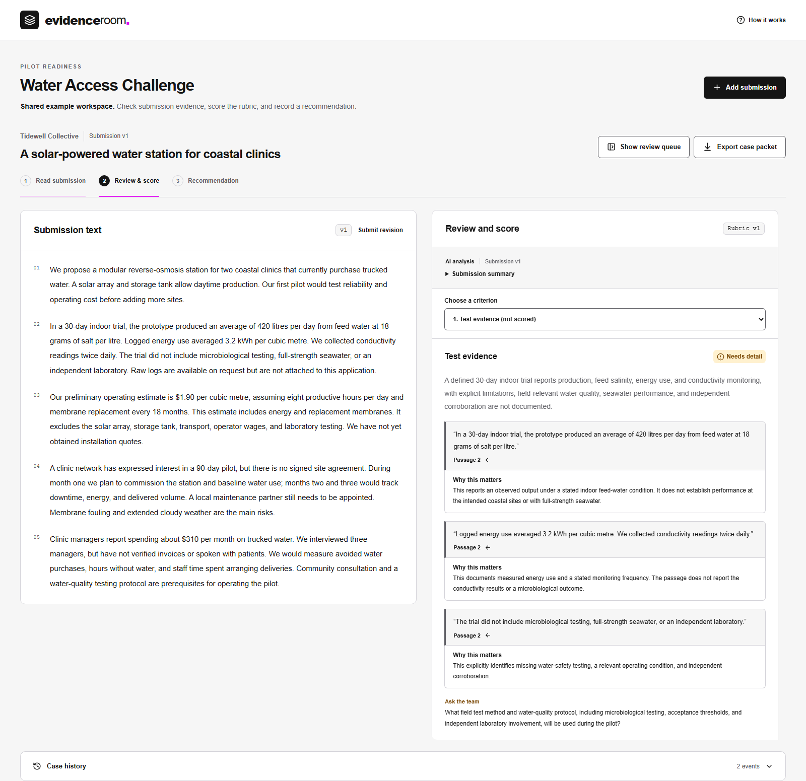

# Evidence Room

A submission review workbench that helps a judge trace findings to source evidence, ask useful clarification questions, and record an independent recommendation.

Open a submission, check its evidence against four criteria, enter your own scores, then export the complete case packet. AI can organize evidence; it never fills in scores or selects an outcome. Three fictional water-access proposals illustrate measured results, unconventional approaches, and unsupported claims.



This is an independent work sample inspired by the XPRIZE Prize Execution Platform role. It has no affiliation with XPRIZE and uses no competitor data or official competition rubric.

## Run locally

Requires Node.js **22.19+**, **.NET 10 SDK**, and **Python 3.11+** on PATH. On Windows the launcher also checks the standard x64 .NET install location. Run these commands from this directory:

```sh
npm ci
npm run build
npm start
```

Open **[http://127.0.0.1:5194](http://127.0.0.1:5194)**. Keep the terminal running. There is no hosted URL for this local sample.

On Windows, stop the running server before `npm run build` or `npm run check`; Windows locks assemblies while they are in use. Use `npm run dev` alongside the API for frontend changes.

Start with **Tidewell Collective → Review the evidence**. Review one criterion at a time using Previous/Next or the criterion selector. The queue hides during review; **Show review queue** reopens it. Click a quotation to highlight its source in yellow, then use **Back to finding** to return. **Review & score** puts a score beside each criterion's evidence. Select a score, then use Next criterion; the selector shows which criteria are scored. **Recommendation** summarizes those scores and collects your rationale and outcome. Edit score returns to that criterion's evidence. Scores and recommendation edits save automatically. Wait for All changes saved before closing the browser; switching submissions and exporting finish pending saves for you. Finalization requires the complete scorecard and confirmation. Hover or focus unavailable Finalize to highlight missing fields in red and see links to complete them; tapping guides you to the first missing requirement. Export downloads JSON containing the rubric, all submission versions and analyses, saved assessment, and event history.

The default workspace needs no API key. Its analyses are labeled **Example analysis**. New submissions can be reviewed manually. Data persists in `.local/evidence.sqlite`; restarting the server retains it. To start a separate workspace, set `EVIDENCE_DB` to a new SQLite file before starting.

## Optional live AI

Set `OPENAI_API_KEY` in the server process environment, then restart `npm start`. The key stays on the server. Never put it in a `VITE_` variable or commit an environment file. Clicking **Run AI analysis** sends the selected submission and rubric to OpenAI and incurs provider charges.

| Setting               | Default                                  | Purpose                                                              |
| --------------------- | ---------------------------------------- | -------------------------------------------------------------------- |
| `OPENAI_MODEL`        | `gpt-5.6-terra`                          | Structured-output model; alternatives must support the same contract |
| `EVIDENCE_AI_LIMIT`   | `10`                                     | Durable total request-attempt allowance for this database; 0–100     |
| `EVIDENCE_DISABLE_AI` | unset                                    | Set to `1` to disable live requests                                  |
| `PYTHON_EXECUTABLE`   | `python` on Windows, `python3` elsewhere | Worker executable                                                    |
| `EVIDENCE_DB`         | `.local/evidence.sqlite`                 | SQLite file location                                                 |

The default is [GPT-5.6 Terra](https://developers.openai.com/api/docs/models/gpt-5.6-terra), using strict structured output and reasoning effort `none` for this bounded extraction task. The Python worker owns the default; `OPENAI_MODEL` remains an explicit override. Older model overrides receive no unsupported reasoning parameter.

One analysis runs at a time. Each attempted request consumes an allowance slot, including failures and cancellations; restarting does not reset it. There are no automatic paid retries. Provider requests have a 30-second timeout, enclosed by a 35-second worker deadline. An invalid quotation, refusal, malformed result, timeout, or stale submission leaves the previous saved analysis intact. Cancellation can still incur a provider charge; canceling after the server commits does not undo an already saved review.

## Verify

```sh
npx playwright install --with-deps
npm run check
```

The default suite needs no paid account. It includes .NET storage/domain tests, Python provider-contract tests, and Chromium/Firefox/WebKit workflow and accessibility checks. Each browser test launches an isolated API with live AI disabled and a temporary database, using ports 5195 and above by worker. Tests clean up their own processes and storage. `npm run check` also runs lint, formatting, TypeScript, and release builds.

Optional paid verification is separate:

```sh
npm run test:live -- --confirm-paid
```

It makes up to three small provider requests through a running local server, including one prompt-injection case, and checks persisted exports. It writes ignored results under `.local/`. Only run it with the key owner's approval. Three such full-path checks were completed during development. A separate browser check of the current default, GPT-5.6 Terra, saved all four criteria, validated 15 source quotations, preserved the human assessment, and verified the exported record. This small evaluation is not evidence of general judging accuracy.

## Design and handoff

- [Review specification](docs/review-spec.md): scope and observable acceptance criteria.
- [Architecture](docs/architecture.md): ownership, transactions, AI trust boundary, and deployment requirements.
- [Product decisions](docs/product-decisions.md): workflow, interaction system, and source research.
- [Interface system](docs/design-system.md): XPRIZE colors, shared tokens, component ownership, and copy rules.
- [Extending the review workflow](docs/extending-reviews.md): reusable spec-driven change process and test map.

The stack is React/TypeScript, ASP.NET Core, SQLite, and a Python Responses API worker. Run `npm run dev` for the Vite frontend on port 5193 alongside the API on 5194; rebuild before using the compiled frontend again.

This is a single-reviewer local application with a fixed illustrative rubric. It does not implement accounts, judge assignment, multi-judge consensus, file ingestion, prize disbursement, or production hosting. Loopback enforcement is intentional. Public deployment needs authentication, authorization, hosted storage, secret management, operational controls, and a reviewed data-retention policy before exposing competitor submissions. Exact quotation validation proves text provenance; the judge still evaluates interpretation and scientific credibility.
