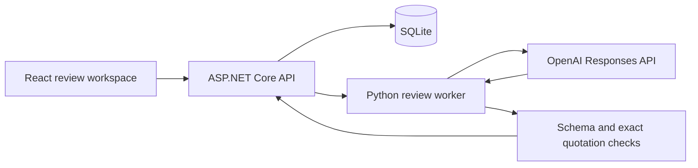

# Architecture

The browser owns unsaved form state. ASP.NET owns identities, revisions, scoring rules, storage, request limits, and commits. Python owns the provider request, output schema, refusal handling, and a second layer of citation validation. There is one caller for the worker and one provider; no plugin framework or general agent orchestration is needed.

`useWorkspace` owns selected-entry identity, cancelable reads, and response ordering. Accepted mutations invalidate older reads before updating the detail and queue summary. `App` owns navigation and focus; `useSavedAction` owns the synchronous save-before-action gate, and `useAnalysis` owns analysis cancellation and controller identity. `useAssessmentDraft` owns the keyed draft and finalization operation; `useAutosave` owns serialized draft writes. Recommendation fields and save feedback are presentation components.

`contracts.ts` defines Zod runtime schemas and infers the browser's TypeScript types from them. Every JSON API call supplies its expected schema; malformed successful responses become recoverable errors before they can acknowledge a draft or enter the workflow. Unknown additive fields are tolerated, historical quote explanations remain optional/nullable, and detail responses must describe one entry/revision. Browser tests exercise these schemas against the actual .NET serializer, including deliberately incompatible successful responses. Cross-language worker tests send actual .NET input through Python's real validation, schema construction, extraction, and emission with a local provider fixture, then consume those emitted bytes through .NET validation and storage. This checks compatibility without assuming that independently authored mock envelopes agree.

`RuntimeSettings` validates configuration once at startup without retaining the API key. `Program` composes the store, worker, and request pipeline. `ReviewerHttpMiddleware` owns host/origin checks, response headers, health, and error translation. The worker envelope parser rejects malformed process output before domain validation. Persistence failures retain their cause for bounded diagnostics; HTTP responses never expose exception details or credentials.

## State and commit boundaries

A submission has a stable entry ID and immutable numbered versions. Paragraph IDs are stable within a version, not across revisions. A revision creates a fresh scorecard and requires a fresh analysis; previous evidence and recommendations remain in the export. Team identity cannot be changed through a submission revision.

An analysis records its source, model, prompt version, submission revision, rubric version, exact citations, and a separate explanation for each quotation. Prompt v2 requires these explanations; readers tolerate null notes in historical v1 records. Startup appends updated authored examples only when no scorecard exists and the original submission still matches. Existing drafts and finalized decisions keep their original analysis reference. AI output is validated before a transaction stores it. The commit rejects a changed submission or finalized scorecard. A failed analysis never replaces an earlier one. AI cannot write the assessment table.

Draft edits debounce for 600 ms and use one serialized writer. Acknowledgment records the submitted client snapshot rather than server-normalized text, preventing save loops on trimmed whitespace. The writer drains newer edits and updates its acknowledged version synchronously. Saves pause during analysis; initiating analysis first flushes the draft. Draft saves carry both the expected submission revision and expected scorecard version. A second tab cannot overwrite a newer draft. Finalization requires every score, a substantive rationale, an outcome, and independent-review confirmation. Totals are calculated on the server from rubric weights. A final recommendation is immutable for that submission version; a new submission revision starts another review.

Navigation, export, analysis initiation, and explicit finalization share a transition gate. These actions wait for pending saves; conflicts stop the writer and preserve local fields. Finalization freezes its snapshot and keeps its confirmation locked through preflight and recording. Unload protection reads pending draft and recording refs directly.

All writes use SQLite transactions. A shared commit method checks hosted capacity and marks successful mutations for durable persistence, so a caller cannot acknowledge a commit while forgetting the snapshot. Multi-part case reads and exports use a read transaction so their submission, analysis, assessment, and event history describe one snapshot. An assessment links to the analysis the judge reviewed, even if a later analysis becomes available. A save against an outdated analysis is rejected. The UI preserves typed work and explains a conflict instead of silently reloading over it.

The rubric in `data/competition.json` is fixed at version 1. Its complete configuration is pinned in SQLite at workspace creation. Startup rejects a changed configuration rather than pairing historical decisions with a new rubric. Restore the original file or use a new `EVIDENCE_DB` path. Databases from development builds without a rubric snapshot also require a new workspace. Editing and migrating live rubrics are outside this sample's contract.

## AI boundary

The worker receives only the rubric, brief, and current narrative passages. Submitted text is untrusted data. It has no tools, browsing, file access instructions, or authority to assign numeric scores. [Structured output](https://developers.openai.com/api/docs/guides/structured-outputs?api-mode=responses) requires one finding per criterion, source quotations with an explanation of each quote's relevance and limitations, clarification questions for gaps, and bounded flags. Python and .NET independently reject invented quotations or citations to another passage. Refusals, incomplete output, unexpected types, and unknown score fields fail closed.

The provider can still misinterpret truthful quotations or omit relevant context. Provenance checks do not verify science or guarantee freedom from prompt injection. Findings are editable only by requesting another analysis; a judge's independent rationale, scores, and recommendation are stored separately. Targeted live checks establish integration behavior on those cases, not model quality across competitions.

A process-level semaphore bounds analysis concurrency. SQLite stores a durable request-attempt count. A worker is terminated on deadline or canceled HTTP request, and no paid request is automatically retried. Process exit and pipe draining share a three-second cleanup deadline. An unconfirmed shutdown poisons the worker before releasing the gate, disables AI availability, and fails hosted liveness; another request cannot start a competing child. Manual review remains usable while the local owner restarts the server or Cloud Run restores the instance. Unexpected process/pipe failure produces a bounded error without replacing saved analysis. Real child-process tests cover deadline, cancellation, overlap, early exit, gate reuse, and failed shutdown. The submission revision is checked again on commit. A client cancellation racing a completed transaction may leave a completed analysis saved; reloading shows authoritative state.

## Local and hosted boundaries

Local execution accepts only loopback clients and Host headers. Hosted execution requires configured exact HTTPS origins and hosts, a private snapshot bucket, and a dedicated runtime identity. Writes require a configured browser Origin and JSON; foreign or missing origins are rejected in hosted mode. Origin checks are browser protections, not authentication. The public site is explicitly a shared synthetic workspace, and Add submission provides a fresh case without changing an existing final record.

Static hosting exposes only `dist/`. A restrictive content security policy loads bundled assets and local fonts; the browser never sees the API key. Firebase serves the interface before the API starts, with a prominent delayed-connection panel after 1.5 seconds and a 45-second connection deadline. Retry and stale-link recovery focus the loaded destination after its data arrives. Ordinary initial visits do not move keyboard focus.

## Durable shared demo

`WorkspaceSnapshot` owns one state gate around each store read and mutation. In hosted mode, a successful transaction is backed up to a standalone SQLite file and conditionally uploaded to a private Cloud Storage object before returning success. Reads cannot observe a mutation while persistence is pending. SQLite and its WAL stay on local disk; no active database is mounted on object storage. `CloudSnapshotStorage` uses the runtime identity, bounded HTTP requests, generation-pinned reads, and generation-match uploads. No persistence or provider write retries automatically.

The generation precondition applies even to the first workspace creation. Two processes cannot commit the same prior generation: a stale writer fails before acknowledging the write or forwarding a reserved AI request. Any uncertain upload makes the workspace unhealthy, blocks reads and writes, and causes the Cloud Run liveness probe to restart it from the durable object. Startup never replaces corrupt, unavailable, or unauthorized storage with a fresh database. A failed acknowledgement can still mean that the remote write committed; the restarted workspace is authoritative.

During a brief overlap of revisions, an older process may serve its last durable read snapshot until a mutation discovers its generation conflict. This demo does not promise globally current reads across replicas. The instance limits reduce overlap and operating cost; conditional storage writes establish mutation and allowance correctness.

The hosted sample caps entries at 50, submission versions at 10 per entry, and database snapshots at 8 MiB. Transaction page size is checked before commit, so a normal capacity rejection rolls back and preserves read/export access. Repetitive draft-save audit events are compacted to the latest per submission version; all submissions, analyses, and final assessments remain in history. The public AI allowance is 25 total attempts shared across visitors, including failures and cancellations, durably reserved before a provider receives input. Account quotas and sensitive multi-organization data remain outside this demo.

See [deployment](deployment.md) for resources, configuration, and the public URL. A production competition platform would add authentication, role-based access, organization isolation, operational monitoring, managed relational storage, and data governance. The .NET/Python boundary can remain a child process for this bounded service; a job queue should follow an actual asynchronous workload requirement.
