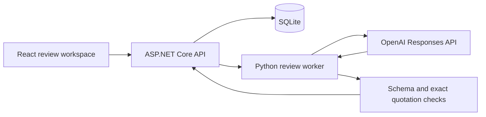

# Architecture

The browser owns unsaved form state. ASP.NET owns identities, revisions, scoring rules, storage, request limits, and commits. Python owns the provider request, output schema, refusal handling, and a second layer of citation validation. There is one caller for the worker and one provider; no plugin framework or general agent orchestration is needed.

## State and commit boundaries

A submission has a stable entry ID and immutable numbered versions. Paragraph IDs are stable within a version, not across revisions. A revision creates a fresh scorecard and requires a fresh analysis; previous evidence and recommendations remain in the export. Team identity cannot be changed through a submission revision.

An analysis records its source, model, prompt version, submission revision, rubric version, and exact citations. AI output is validated before a transaction stores it. The commit rejects a changed submission or finalized scorecard. A failed analysis never replaces an earlier one. AI cannot write the assessment table.

Draft edits debounce for 600 ms and use one serialized writer. Acknowledgment records the submitted client snapshot rather than server-normalized text, preventing save loops on trimmed whitespace. The writer drains newer edits and updates its acknowledged version synchronously. Saves pause during analysis; initiating analysis first flushes the draft. Draft saves carry both the expected submission revision and expected scorecard version. A second tab cannot overwrite a newer draft. Finalization requires every score, a substantive rationale, an outcome, and independent-review confirmation. Totals are calculated on the server from rubric weights. A final recommendation is immutable for that submission version; a new submission revision starts another review.

Navigation, export, analysis initiation, and explicit finalization share a transition gate. These actions wait for pending saves; conflicts stop the writer and preserve local fields. Finalization freezes its snapshot and keeps its confirmation locked through preflight and recording. Unload protection reads pending draft and recording refs directly.

All writes use SQLite transactions. Multi-part case reads and exports use a read transaction so their submission, analysis, assessment, and event history describe one snapshot. An assessment links to the analysis the judge reviewed, even if a later analysis becomes available. A save against an outdated analysis is rejected. The UI preserves typed work and explains a conflict instead of silently reloading over it.

The rubric in `data/competition.json` is fixed at version 1. Its complete configuration is pinned in SQLite at workspace creation. Startup rejects a changed configuration rather than pairing historical decisions with a new rubric. Restore the original file or use a new `EVIDENCE_DB` path. Databases from development builds without a rubric snapshot also require a new workspace. Editing and migrating live rubrics are outside this sample's contract.

## AI boundary

The worker receives only the rubric, brief, and current narrative passages. Submitted text is untrusted data. It has no tools, browsing, file access instructions, or authority to assign numeric scores. Structured output requires one finding per criterion, source quotations, clarification questions for gaps, and bounded flags. Python and .NET independently reject invented quotations or citations to another passage. Refusals, incomplete output, unexpected types, and unknown score fields fail closed.

The provider can still misinterpret truthful quotations or omit relevant context. Provenance checks do not verify science or guarantee freedom from prompt injection. Findings are editable only by requesting another analysis; a judge's independent rationale, scores, and recommendation are stored separately. The three small live checks establish integration behavior on those cases, not model quality across competitions.

A process-level semaphore bounds analysis concurrency. SQLite stores a durable request-attempt count. A worker is terminated on deadline or canceled HTTP request, and no paid request is automatically retried. The submission revision is checked again on commit. A client cancellation racing a completed transaction may leave a completed analysis saved; reloading shows authoritative state.

## Local security and hosting

Only loopback clients and loopback Host headers are accepted. Writes require JSON and reject foreign browser origins. The API caps request bodies, rejects unknown request fields, and reports bounded errors. Static hosting exposes only `dist/`. A restrictive content security policy loads bundled assets and local fonts; the browser never sees the API key. These controls support a local workbench, not a substitute for authentication.

Deploying to Azure or another public host requires a separate, explicit change: identity and role-based authorization, judge/submission access policies, managed secrets, a durable relational database and migration plan, rate limits per account, monitoring, backups, and data governance. The current SQLite file and single-process allowance are deliberately scoped to one local instance. The .NET/Python boundary can remain a child process for a small service; move it to a durable job queue only when asynchronous workloads and operating requirements justify that complexity.
